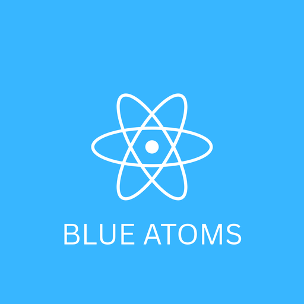

# Atomic Space



**Design it. Fly it. Find out why.**

A space mission design game for one to four players, written in Object Pascal
(the Delphi language) and played in a web browser.

**Play it now: https://tradespace-blue-atoms.vercel.app**

**Windows desktop edition (Delphi VCL): https://tradespace-blue-atoms.vercel.app/desktop**

Built by team **Blue Atoms** for the 2026 NASA Space Apps Challenge,
[Space Mission Design Game](https://www.spaceappschallenge.org/2026/challenges/space-mission-design-game/).
Atomic Space is not affiliated with or endorsed by NASA.

---

## Contents

1. [What the game is](#what-the-game-is)
2. [How it answers the challenge](#how-it-answers-the-challenge)
3. [NASA data and resources](#nasa-data-and-resources)
4. [How to play](#how-to-play)
5. [How it works](#how-it-works)
6. [Build it yourself](#build-it-yourself)
7. [Desktop edition (Delphi)](#desktop-edition-delphi)
8. [Put it online](#put-it-online)
9. [The plan](#the-plan)
10. [Submission checklist](#submission-checklist)
11. [Use of AI](#use-of-ai)
12. [Credits and references](#credits-and-references)

---

## What the game is

You are a mission design team. A space agency asks for a mission and sets a
cost cap and a deadline. You choose the orbit, the instruments, the spacecraft,
the power system, the radio, the rocket and the plan. A review board tells you
what will fail and why. Then you fly it, deal with what goes wrong, and read a
report that explains the result and compares your design with a real mission.

The point of the game is one idea: **every choice is a trade**. Add a radar and
you get more science. You also get 30 kg more equipment, so more propellant,
so less launch margin. You get 150 W more load, so a bigger solar array, so
more mass again. You get a flood of data, so a bigger dish or lost science.
The game shows that ripple every time you click.

Five missions, each modelled on real ones:

| Mission | Destination | What makes it hard | Level |
| --- | --- | --- | --- |
| Disaster Watch | Earth orbit | Your targets are **real natural events happening now** (NASA EONET). Where they are decides the orbit. | 1 |
| Ice Prospector | Moon | The ice is at the poles, and the instrument that finds it only works close to the surface. | 1 |
| Follow the Water | Mars | Launch windows every 26 months, a signal that takes up to 22 minutes, and a data link 200 times weaker than at the Moon. | 2 |
| Race to Apophis | Asteroid Apophis | The **real flyby on 13 April 2029** is the deadline. Anything big cannot be built in time. | 2 |
| Ocean World | Europa | Sunlight is 27 times weaker and Jupiter's radiation kills electronics. Solar or nuclear? Orbit or flyby? | 3 |

## How it answers the challenge

| The challenge asks for | In Atomic Space |
| --- | --- |
| Define a mission objective first | Every game starts with a briefing: objective, science priorities, cost cap, deadline. |
| Design a spacecraft with real subsystems | Bus, propulsion, attitude control, thermal, radiation shielding, power, antenna, radio band, transmitter, computer and recorder. Simple and advanced options for each. |
| Select instruments with mass, power, cost, data and science value | 15 instruments based on real ones, each with all five, plus what it needs (steady pointing, a cryocooler, a dish). |
| Choose an orbit and a launch vehicle, and check they match | Orbits with coverage, shadow, radiation and fuel cost. 12 real launchers from NASA partners and industry. The game checks mass against the rocket's capacity for that orbit or escape route. |
| Manage budget, mass, power, communications, data, time | Seven live gauges. Click any one for the breakdown. |
| Every decision has a consequence | The "ripple" line shows what your last click did to everything else. |
| There is rarely one perfect solution | A 36 kg CubeSat and a 1.4 tonne nuclear probe can both succeed. The score rewards value for money, not size. |
| Simulate the mission | Development surprises, launch, cruise, arrival and week-by-week operations, with decisions to make. |
| Explain why a mission succeeds or fails | The review board before launch and the report after it both say what, why and what to try. |
| Team play for up to four, with roles and negotiation | Four roles with tabs of their own and goals that conflict. A go/no-go poll before launch. Decisions in flight go to the role that owns the system. |
| Different difficulty levels and scenarios | Three difficulty levels, five missions, and a sandbox with no cost cap. |
| Random events | Yes, and many are real: solar storms from NASA's records arrive on their real dates. |
| Mission dashboards, reports, post-mission analysis | Live mission control with charts, then a scored report with reasons. |
| Save, share and compare; leaderboards | A mission log ranked by score, and share links that give another team the same design and the same luck. |
| Accessible to beginners | Plain language throughout, a glossary of 27 terms, an example design for every mission, and a Cadet level. |

## NASA data and resources

NASA data is not decoration here. Three live services change how the game plays.

| Source | What the game does with it |
| --- | --- |
| [EONET](https://eonet.gsfc.nasa.gov/) (Earth Observatory Natural Event Tracker) | Loads the real wildfires, storms, floods and ice events of the last 30 days. Their **locations** decide what each orbit can see. Their **types** set the science priorities. Change nothing and play tomorrow, and the best design may be different. |
| [DONKI](https://ccmc.gsfc.nasa.gov/tools/DONKI/) (Space Weather Database) | A year of real solar flares, particle storms and geomagnetic storms. They strike the spacecraft during every mission, and the log names each one. |
| [NeoWs](https://api.nasa.gov/) and JPL close-approach data | The real Apophis flyby date, distance and speed. The countdown is real, so the deadline in *Race to Apophis* shrinks every day. |
| [GIBS](https://www.earthdata.nasa.gov/engage/open-data-services-software/earthdata-developer-portal/gibs-api) Blue Marble | The world map the events are plotted on. |
| NASA image [KSC-08pd1628](https://images.nasa.gov/details/KSC-08pd1628) | The sky and clouds of the launch scene. |

A snapshot of the data ships with the game (`public/data/nasa-snapshot.json`)
so it works offline or behind a firewall. EONET is then refreshed live in the
browser.

NASA resources from the challenge page that shaped the design:

- [Design and Develop Science Missions](https://www.nasa.gov/wp-content/uploads/2025/04/250323-design-and-develop-science-mission.pdf): the launch, space, ground and user segments are the tabs of the design lab.
- [Concept Maturity Levels](https://dataverse.jpl.nasa.gov/dataset.xhtml?persistentId=hdl:2014/44299) (JPL): the game walks an idea from objective to trade space to point design to review.
- [Mission Design Lab](https://etd.gsfc.nasa.gov/capabilities/integrated-design-center/mission-design-lab/) (Goddard): the review board and the disciplines it checks.
- [A Learning Game About Telescopes](https://science.nasa.gov/mission/webb/game-build-it-yourself/): the idea of ending by naming the real mission your design resembles.
- [CubeSat 101](https://www3.nasa.gov/sites/default/files/atoms/files/nasa_csli_cubesat_101_508.pdf): the CubeSat bus and its limits.
- [GMAT](https://software.nasa.gov/software/GSC-19468-1) and [Mission Viz](https://nasa.github.io/mission-viz/): the orbit and trajectory views.

Space agency partners appear throughout: rockets from ISRO, ESA and JAXA,
and real missions from ISRO, ESA, JAXA, CSA, ASI, KASA and the UAE with links
to their pages.

All masses, costs, data rates and rocket capacities are simplified from public
figures and rounded for teaching. They are not engineering data.

## How to play

1. **Start a mission.** Pick a mission, a difficulty and a crew of one to four.
2. **Read the briefing.** It says what the science team wants and what makes the destination hard.
3. **Design.** Work through the seven tabs. Watch the gauges and the ripple line. If you are stuck, press *Load an example design*.
4. **Review board.** Red findings must be fixed. Amber ones are your call.
5. **Fly.** Answer the decisions as they come. Use Slow, Fast or Fastest.
6. **Read the report.** Then press *Improve this design and fly again*.

With a crew, each player owns some of the tabs and has a goal of their own:

| Role | Owns | Personal goal |
| --- | --- | --- |
| Project Manager | Launch, risk, schedule, reserves | Finish within the cost cap and meet the deadline |
| Science Lead | Orbit, payload | Return at least 85 % of the science goal |
| Spacecraft Engineer | Bus, propulsion, pointing, thermal, power | Launch with 10 % mass margin and 20 % power margin, and keep the spacecraft alive |
| Comms and Ops Lead | Antenna, radio, ground network, computer | Get at least 90 % of the recorded data home |

Those goals pull against each other. That is deliberate.

## How it works

The whole game is Object Pascal. There is no JavaScript source: the
[pas2js](https://getpas2js.freepascal.org/) compiler turns the Pascal into
one JavaScript file that the page loads.

```
src/
  tradespace.lpr        program entry
  core/                 the mission engine. Plain Object Pascal, no browser
                        code, so it also compiles in Delphi and Free Pascal.
    TsTypes.pas         shared types and physical constants
    TsCatalog.pas       instruments, subsystems, launch vehicles, glossary
    TsScenarios.pas     the five missions; applies live NASA data
    TsEngine.pas        analysis: mass, power, propellant, link, cost, risk,
                        and the review board's findings
    TsSim.pas           the simulation: development, launch, cruise, operations
    TsScore.pas         scoring, post-mission analysis, team goals
    TsExamples.pas      one worked example per mission
    TsFmt.pas           number formatting
  web/                  the browser front end (pas2js only)
    WebApp.pas          events, screens, animation loop
    WebViews.pas        every screen, built as HTML text
    WebDraw.pas         canvas: orbit view, blueprint, map, launch, charts
    WebNasa.pas         loads EONET, DONKI and Apophis data
    WebStore.pas        mission log in the browser's local storage
    WebState.pas        current design, crew and mission
    WebUtil.pas         small page helpers
public/                 what is served: index.html, css, assets, data,
                        and the compiled js/tradespace.js
tests/coretests.lpr     checks for the engine, run under Node.js
scripts/                setup, build, test and the NASA data snapshot
legacy-delphi-vcl/      the team's original Windows prototype
```

The models, in one line each:

- **Propellant:** the Tsiolkovsky rocket equation, including tank mass. This is why 1 kg of instrument costs more than 1 kg at launch.
- **Launch:** each rocket's capacity falls exponentially with launch energy (C3), fitted to published figures.
- **Power:** 1,361 W/m2 at Earth, falling with the square of distance from the Sun; an energy balance over one orbit including shadow and battery losses.
- **Data:** rate is transmitter power times dish area times band times ground antenna, over distance squared. Calibrated so a Mars Reconnaissance Orbiter-like radio gives MRO-like rates.
- **Science:** each instrument scores against the mission's priorities, adjusted for orbit, pointing, cooling, power and data return, and approaches its ceiling with diminishing returns over time.
- **Risk:** a fault rate set by the bus, the risk class, the schedule and radiation exposure; about one fault in five ends a mission.
- **Luck:** a seeded random number generator, so a shared design meets the same surprises.

The tests check the physics against reality: a Juno-sized array gives about
500 W at Jupiter, doubling delta-v more than doubles propellant, a polar orbit
sees events a tropical one cannot, and every example design passes review.

## Build it yourself

You need Windows, PowerShell and [Node.js](https://nodejs.org/). You do not
need Delphi to build the game, but the files open in the Delphi editor.

```powershell
# 1. Once: download the free pas2js compiler into tools\ (about 13 MB)
powershell -ExecutionPolicy Bypass -File scripts\setup.ps1

# 2. Compile the Pascal to public\js\tradespace.js
powershell -ExecutionPolicy Bypass -File scripts\build.ps1

# 3. Run the engine tests
powershell -ExecutionPolicy Bypass -File scripts\test.ps1

# 4. Refresh the NASA data snapshot (optional)
node scripts\fetch-nasa-data.mjs

# 5. Play it locally at http://localhost:5173
python -m http.server 5173 --directory public
```

To use your own NASA API key for the snapshot, get one free at
https://api.nasa.gov and run `$env:NASA_API_KEY = "your key"` before step 4.
The shared `DEMO_KEY` works but allows only a few requests an hour.

Changing the game: edit the `.pas` files, run `build.ps1`, refresh the page.
To add an instrument, add one `AddInstr` line in `TsCatalog.pas` and its id to
a mission's `Offer` list in `TsScenarios.pas`.

## Desktop edition (Delphi)

**Download: https://tradespace-blue-atoms.vercel.app/desktop**
(Windows 10/11, 15 MB zip, no install). Source: [desktop-atomic-space/](desktop-atomic-space/).

The desktop edition is the team's original Windows game, built in Delphi 12 (VCL).
It is the same idea as the browser edition at a smaller scale: one destination (the
Moon), three missions, and a launch and landing you fly yourself.

| Step | What happens | Trade-off it teaches |
| --- | --- | --- |
| Mission | CubeSat Pathfinder (8 t, $150 M cap), Lunar Science Orbiter (35 t, $220 M), Cargo Lander (80 t, $300 M). Each is matched to a real NASA mission: CAPSTONE, LRO, CLPS/Artemis. | Objectives come first and set the constraints. |
| Build | 3 ships x 3 thrusters x 2 or 4 boosters = 18 designs. | Bigger ships carry and hold more, but weigh and cost more. |
| Review board | Live thrust-to-weight, budget, payload and fuel checks. RED blocks launch, AMBER warns, GREEN praises. | Thrust-to-weight below 1.15 wastes fuel; above 2.5 wastes money. |
| Team go/no-go | 1-4 players on one screen share four roles; each must sign off, and any change resets the sign-offs. | Negotiation between budget, mass, science and fuel. |
| Launch | Countdown, lift-off only if thrust beats weight, fuel drains live, boosters separate at 100,000 ft. | Newton's second law, staging. |
| Moon | Hold a 100 km orbit, then land manually or with autopilot. The tank starts as full as the design's fuel margin allows. | Margins decided early matter late. |
| Report | Score /100 and grade, with the reasons and the real mission it resembles. | Why it worked, not just whether. |

Every mission has between 3 and 6 designs that pass review, and none of them is best on every count.

### Build it from source

Open `desktop-atomic-space/AtomicSpace_p.dproj` in Delphi 12 (Community
Edition is fine) and press **Shift+F9**. The program finds its `Assets`
folder next to the `.exe` or two folders up, so it runs from `Win32\Debug`.

Community Edition does not allow the `dcc32` command-line compiler, but the
IDE can build without opening a window:

```powershell
& "C:\Program Files (x86)\Embarcadero\Studio\23.0\bin\bds.exe" -ns -b "desktop-atomic-space\AtomicSpace_p.dproj"
```

To publish a new download: copy `Win32\Debug\AtomicSpace_p.exe` (as
`AtomicSpace.exe`) and the `Assets` folder into a folder called
`AtomicSpace-Desktop`, zip it to
`public/downloads/AtomicSpace-Desktop-Windows.zip`, then deploy.

| File | What it does |
| --- | --- |
| `MissionPlan_u.pas` | Missions, part data, review board, scoring. No forms, easy to test. |
| `Game.pas` | Planner: part picker, mission panel, review board, team sign-off, report. |
| `Launch_u.pas` | Launch: countdown, physics, fuel, staging, telemetry. |
| `Unit1.pas` | Moon: orbit hold and landing, manual or autopilot. |
| `StartUp_u.pas` | Start screen. |
| `Assets/TextFile/*.txt` | Part data (mass, thrust, fuel, cost). Edit them to rebalance. |

## Put it online

### Vercel

The site is plain files in `public/`, so Vercel needs no build step
(`vercel.json` says so). The compiled `public/js/tradespace.js` is committed
for that reason: **run `build.ps1` before every deploy.**

```powershell
npm install -g vercel        # once
vercel login                 # once
vercel link --yes --project tradespace-blue-atoms
vercel deploy --prod --yes
```

Or connect the GitHub repository in the Vercel dashboard (Add New, Project,
import the repository, Framework Preset: Other, Output Directory: `public`,
no build command). After that, every push to `main` redeploys.

### GitHub

```powershell
git init
git branch -M main
git add .
git commit -m "Atomic Space: space mission design game"
git remote add origin https://github.com/King-Daniel123/NASA-Space-App-Challenges---BLUE-ATOMS.git
git push -u origin main
```

After the first push, updating is `git add . ; git commit -m "what changed" ; git push`.

## The plan

### Where the project started

A Delphi VCL program with one launch scene and about 130 lines of code. It
did not build (`Unit2.pas` had a syntax error), had no mission design in it,
and as a Windows `.exe` could not be hosted on Vercel or opened by a judge
from a link. The full list of faults is in
[legacy-delphi-vcl/README.md](legacy-delphi-vcl/README.md).

In parallel the team built the first *Atomic Space*, a larger Delphi VCL game with a
rocket builder, a launch scene and a Moon landing, but with no mission
objectives, no budget or review, and a few bugs. Those are fixed and
listed in [desktop-atomic-space/README.md](desktop-atomic-space/README.md).

### What has been done

- [x] Read the challenge, its resources tab, the judging guide and the submission guide.
- [x] Moved from a Windows program to Object Pascal compiled for the browser, so the game stays in Pascal and runs from a link.
- [x] Mission engine: catalogue, analysis, review findings, simulation, scoring (about 5,000 lines of Object Pascal, out of roughly 10,000 in the project), with 765 automated checks.
- [x] Five missions, 15 instruments, 12 launch vehicles, 40 subsystem options, 27 glossary terms.
- [x] Live NASA data in the gameplay: EONET, DONKI, NeoWs, GIBS.
- [x] All screens: title, setup, briefing, design lab, review board, mission control, report, mission log.
- [x] Drawn in code: spacecraft blueprint, animated orbit view, event map, launch, cruise, charts.
- [x] Team mode with four roles, conflicting goals and a go/no-go poll.
- [x] Share links, mission log, example designs, three difficulty levels, sandbox.
- [x] Deployed to Vercel and pushed to GitHub.
- [x] Desktop edition: the team's Delphi VCL game *Atomic Space* now has missions, a live review board, team sign-off, staging, fuel limits and a scored report. It is built and tested on Windows and can be downloaded from `/desktop`.

### What the team must do before the deadline

See the [submission checklist](#submission-checklist). The short version:
fill in the team names, record or review the demo, paste the form text, and
press *Submit for Judging* before **Sunday 15 November, 11:59 p.m.** local time.

### What to do next, in order of value

1. **Play-test with real students.** Watch three people who have never seen it. Note where they stop. Fix the wording there first.
2. **Balance.** Play every mission at every level. The cost caps and the science goals in `TsScenarios.pas` are the main dials.
3. **Online team play.** Today a crew shares one screen (or shares it over a video call). True rooms across devices need a small real-time service. The simulation is already deterministic from a seed and a list of decisions, which is the hard part.
4. **A global leaderboard.** The log is per device. A shared one needs a small database and a way to check scores (re-run the seed on the server).
5. **More missions.** A space telescope at L2 (pointing and cooling drive everything), a Venus orbiter (heat), a comet sample return. Each is one procedure in `TsScenarios.pas`.
6. **Sound.** Countdown, engine rumble, alerts. Add with care: the rules require any AI-made audio to be declared.
7. **Phone layout polish.** It works on a phone, but the design lab is built for a laptop screen.
8. **One engine for both editions.** The desktop edition now exists (`desktop-atomic-space/`) with its own small rule set. Next step: drive it with the browser edition's `core` units, which are plain Object Pascal, so both editions share missions and physics. They have not been compiled in Delphi yet.
9. **Translations.** All text is in the Pascal source. Moving it into resource strings would make the game translatable.
10. **Teacher's guide.** A one-page lesson plan: which mission to use for which idea (inverse-square law, rocket equation, orbits and coverage).

### Known limits

- The numbers are teaching approximations. Do not size a real spacecraft with them.
- Launch windows and the Mars deadline are fixed at late-2026 values. Only the Apophis clock follows the real calendar.
- DONKI data comes from the bundled snapshot. Run `fetch-nasa-data.mjs` to refresh it.
- The mission log lives in the browser. Clearing site data clears it.
- The `core` units have been compiled with pas2js only. Building them in the Delphi IDE should work but has not been tried.

## Submission checklist

Deadline: **Sunday 15 November 2026, 11:59 p.m.** in your local event's time zone.

- [ ] Every team member is registered for the same local event and shows on the team's Members tab. At most six members.
- [ ] Open *My Team*, then the *Project* tab, then *Edit*.
- [ ] Paste the text from [docs/SUBMISSION.md](docs/SUBMISSION.md) into each field. Check every sentence is true for your team and change what is not.
- [ ] **Link to Final Project:** `https://tradespace-blue-atoms.vercel.app` (the desktop edition is linked from the README and at `/desktop`)
- [ ] **Link to Project Demo:** the slides at `https://tradespace-blue-atoms.vercel.app/slides/` (seven slides), or your own video of 30 seconds or less.
- [ ] Put your team name and members on slide 1: edit `public/slides/index.html`, then build and deploy again.
- [ ] Open both links in a private browser window to check they work without logging in.
- [ ] Fill in the *Use of AI* field honestly. See [Use of AI](#use-of-ai).
- [ ] List every source in the references field. They are in [Credits and references](#credits-and-references).
- [ ] Tick both boxes and press **Submit for Judging**. You can edit and resubmit until the deadline.
- [ ] Optional but recommended: request a [FortiGuard web filter classification](https://www.fortiguard.com/faq/wfratingsubmit) for the site (category: Education; company name: N/A) so judges' networks do not block it.
- [ ] Confirm where the rocket artwork in the old prototype came from, or leave it out (see [legacy-delphi-vcl/README.md](legacy-delphi-vcl/README.md)).
- [ ] Desktop edition: the team says its artwork is their own. Check the Milky Way photo on the start screen is yours or public domain, and keep the "Mission Director" caricature hidden (it resembles a real person).

How the game lines up with the five judging criteria:

| Criterion | What to point at |
| --- | --- |
| Impact | Any student with a browser can run a whole mission in ten minutes, alone or as a class of four. No install, no account, free. |
| Creativity | Real events on Earth choose your targets. A real asteroid sets your deadline. Real solar storms hit your spacecraft. The ripple line makes trade-offs visible. |
| Validity | Rocket equation, inverse-square laws, energy balance and link budget, checked by 765 tests against real missions. |
| Relevance | Covers every objective and almost every "potential consideration" of the challenge, with four NASA data services at the centre of play. |
| Presentation | Seven-slide demo, this README, and a game that explains itself. |

## Use of AI

The rules ask teams to say where AI tools were used.

- **Code and text:** the Object Pascal source, the in-game text, this README and the code that draws the graphics were written with the help of Claude, an AI model made by Anthropic (through Claude Code). Each source file says so in its header, and `index.html` carries it as metadata.
- **Images, audio and video:** none are AI-generated. Every picture in the game is drawn by the program from the numbers in the player's design, or is a NASA photograph or map.
- **NASA branding:** no NASA logos, flags or mission insignia appear anywhere.

The rules also say AI should speed up the work, not supply the idea. The idea
of a mission design game with a launch scene in Delphi was the team's. When
you fill in the *Use of AI* field, describe in your own words what the team
did and what the AI did. Be accurate: judges can see the notes above.

## Credits and references

**Data**
- NASA EONET v3, https://eonet.gsfc.nasa.gov/docs/v3
- NASA CCMC DONKI, https://ccmc.gsfc.nasa.gov/tools/DONKI/
- NASA NeoWs (Near Earth Object Web Service), https://api.nasa.gov/ ; JPL Small-Body Database, https://ssd.jpl.nasa.gov/
- NASA GIBS, layer BlueMarble_NextGeneration, https://www.earthdata.nasa.gov/

**Images**
- NASA, KSC-08pd1628, "Gathering clouds filter the painted sky over the turn basin", Dimitri Gerondidakis, 11 June 2008. Used for the launch sky and cloud cut-outs.
- NASA Blue Marble Next Generation, via GIBS. Used for the world map.

**NASA resources (from the challenge page)**
- Design and Develop Science Missions; General Mission Analysis Tool; Concept Maturity Levels (JPL); Mission Design Lab (GSFC); NASA Mission Viz; A Learning Game About Telescopes; CubeSat 101.

**Other NASA references for the numbers**
- NASA Planetary Fact Sheets (NSSDCA); mission pages on science.nasa.gov for LRO, Lunar Prospector, Lunar Trailblazer, CAPSTONE, MRO, MAVEN, Mars Odyssey, ESCAPADE, MarCO, DART, NEAR Shoemaker, OSIRIS-REx, OSIRIS-APEX, Europa Clipper, Juno, Galileo, New Horizons, Landsat 9, TROPICS, NISAR, CYGNSS, Terra; NASA Systems Engineering Handbook; State-of-the-Art of Small Spacecraft Technology.

**Space agency partners**
- ISRO (PSLV, LVM3, Chandrayaan-1, Mangalyaan, NISAR), ESA (Ariane 6, Vega-C, SMART-1, JUICE, Ramses), JAXA (H3, Hayabusa2, Akatsuki), CSA (OSIRIS-REx laser altimeter, MOPITT), ASI (LICIACube), KASA (Danuri), UAE Space Agency / MBRSC (Hope).

**Tools**
- [pas2js](https://getpas2js.freepascal.org/) 3.2.0, the Free Pascal to JavaScript compiler (LGPL with linking exception for its run-time library).
- Node.js for the tests and the data snapshot. Vercel for hosting.
- Claude (Anthropic) as a coding assistant.

**Licence:** MIT, see [LICENSE](LICENSE). NASA data and images are in the public domain.

**Desktop edition artwork:** rocket, thruster, crane, background and Moon-mission pictures made by team Blue Atoms. Screenshots on `/desktop` are of the program itself.

**Team Blue Atoms**, Centre of Science and Technology (COSAT), Khayelitsha: Inam Lubisi, Mehluko Mseleni, Bokamoso Mbakaza, Siqhamo Malashe and Onako Peteni.
